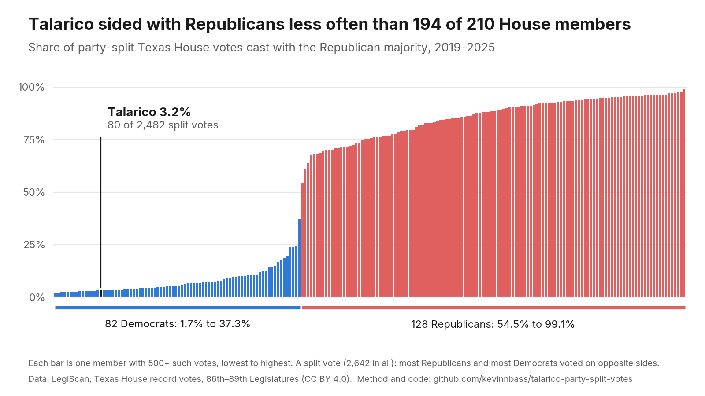

# When the parties split, how often did James Talarico vote with Republicans?

Texas House record votes, 2019–2025.



## The finding

On the Texas House votes where most Republicans and most Democrats voted on opposite sides, James Talarico voted with
the Republican majority **80 times out of 2,482: 3.2%**.

Of the 210 House members with 500 or more such votes, **194 sided with Republicans more often**: all 128 Republicans
and **66 of the 82 Democrats**. Fifteen Democrats did so less often.

## How it was measured, in plain English

1. **Every recorded vote.** We started with all 10,460 record votes in the Texas House from January 2019 through
   2025: the 86th, 87th, 88th and 89th Legislatures, regular and special sessions.
2. **Only the votes where the parties split.** On most House votes the two parties agree. We kept only the 2,642
   where most Republicans voted one way and most Democrats the other. If a party's own members were evenly split, the
   vote was left out.
3. **Which side each member took.** On each of those votes, a member either voted with the Republican majority or
   with the Democratic majority. Only yes and no votes count. Absences and "present, not voting" are left out.
4. **The score.** A member's score is the share of their split votes cast with the Republican majority.
   Talarico's: 80 of 2,482.
5. **Who is shown.** Every member with at least 500 split votes, 210 in all, from lowest score to highest. The
   cutoff leaves out members who served too briefly for a stable score.

Every vote counts once, including amendments, procedural motions and each stage of a bill, because those are all
votes a member chooses how to cast. The checks below show what happens if you count only final passage.

## Change the choices and the answer holds

Each line recomputes Talarico's score and rank with one choice changed (`python robustness.py`;
[output/robustness.csv](output/robustness.csv)).

| Check | Split votes | Talarico | Democrats who sided with Republicans more often |
|---|---:|---:|---:|
| As charted (500+ votes) | 2,642 | 3.2% (80 of 2,482) | 66 of 82 |
| Cutoff of 100 votes | 2,642 | 3.2% | 71 of 87 |
| Cutoff of 1,000 votes | 2,642 | 3.2% | 50 of 64 |
| 86th Legislature only (2019) | 307 | 4.3% (13 of 299) | 56 of 65 |
| 87th Legislature only (2021) | 676 | 2.4% (16 of 672) | 49 of 66 |
| 88th Legislature only (2023) | 663 | 2.0% (13 of 660) | 52 of 64 |
| 89th Legislature only (2025) | 996 | 4.5% (38 of 851) | 42 of 62 |
| Final passage and conference/concurrence votes only | 927 | 4.1% (35 of 852) | 64 of 82 |
| Procedural motions, motions to table and statements removed | 2,199 | 3.4% (71 of 2,068) | 64 of 82 |

- **Members served different years.** The one-Legislature rows compare him only with the members who sat in the same
  session, on the same votes. He is in the lowest third of Democrats in each.
- **"Most of those votes were procedural."** Counting only final passage and conference or concurrence votes, he
  is at 4.1%, and 64 of 82 Democrats crossed over more often.
- Motion types in those two rows come from LegiScan's one-line description of each vote. The single-Legislature
  checks use a 100-vote cutoff, since one Legislature has at most 996 split votes.

## Is the data right?

The votes come from [LegiScan](https://legiscan.com)'s public datasets for each session, included unchanged in
[data/legiscan](data/legiscan) with their sha256 hashes in
[MANIFEST.json](data/legiscan/MANIFEST.json). They were checked against the official record, the Texas House Journal:

- **Totals.** On 2,641 of the 2,642 split votes, the Yea and Nay totals in LegiScan match the totals printed in the
  House Journal ([checks/journal_totals.csv](checks/journal_totals.csv), which links each row to its Journal PDF and
  page). The one exception is HB 7 in the 89th Legislature's second special session (Record 135), where LegiScan
  has 83–47 and the Journal prints 82–48. That is one member's vote, below.
- **Every member's vote.** On all 2,642 split votes, each member's vote in LegiScan was compared with the names the
  Journal prints under Yeas, Nays, Present not voting and Absent: 395,582 member-votes. They agree on all but two
  ([checks/journal_member_disagreements.csv](checks/journal_member_disagreements.csv)):
  - Brian Harrison on HB 7 (Record 135): LegiScan has Yea; the Journal lists him under Nays and prints his statement,
    "When Record No. 135 was taken, I was shown voting no. I intended to vote yes."
  - The Speaker on Record 1358 of the 2025 regular session: absent in LegiScan, present-not-voting in the Journal.
    Neither is a yes or no.
- **Recomputed from the Journal alone.** Using the Journal's own lists instead of LegiScan gives the same 2,642 split
  votes, the same 210 members, and the same result for Talarico: 80 of 2,482, with 194 members higher. The Journal
  also has 53 split votes that are missing from LegiScan's data. Counting them, he is at 81 of 2,523 (3.2%), with
  66 of 82 Democrats and 194 of 210 members higher
  ([checks/journal_rates.csv](checks/journal_rates.csv): Journal counts first, LegiScan counts after).
- **Talarico's votes.** His position matches the Journal on all 10,460 record votes, split or not.

The Journal was read from the text layer of all 467 House Journal PDFs for 2019–2025 (no OCR), and printed names were
matched to LegiScan's member list for each session by surname, with initials where the Journal uses them.

## What this does not measure

- **Bipartisan work.** This counts how he voted when the parties divided. It does not count bills he wrote with
  Republicans, committee work, or the large majority of votes where the parties agreed.
- **Why he voted as he did.** A vote with the Democratic majority can be for many reasons; the score records the
  side, not the reason.

## One member changed parties

Ryan Guillen is listed in LegiScan as a Democrat in the 2019 and 2021 sessions and a Republican from 2023. Like every
member, he is shown under his latest party, with all his votes counted: 54.5%, the lowest Republican bar. He sided
with the Republican majority on 35.2% of his split votes (283 of 805) in 2019–21 and 64.2% (1,027 of 1,599) in 2023–25.
This changes nothing about Talarico's numbers. In the one-Legislature checks he is also counted as a Republican.

## Reproduce it

```bash
pip install -r requirements.txt
python make_figure.py       # -> output/talarico_party_split.png and data/house_split_votes.csv
python robustness.py        # -> output/robustness.csv
```

[data/house_split_votes.csv](data/house_split_votes.csv) has every charted member's count, total and rate.

## License

- **Code:** MIT, see [LICENSE](LICENSE).
- **LegiScan data** (`data/legiscan/`): © LegiScan LLC, [CC BY 4.0](https://creativecommons.org/licenses/by/4.0/),
  included unmodified. LegiScan does not endorse this work.
- **Derived data** (`data/house_split_votes.csv`, `output/`, `checks/`): CC BY 4.0, computed from the LegiScan data
  by the scripts here.
